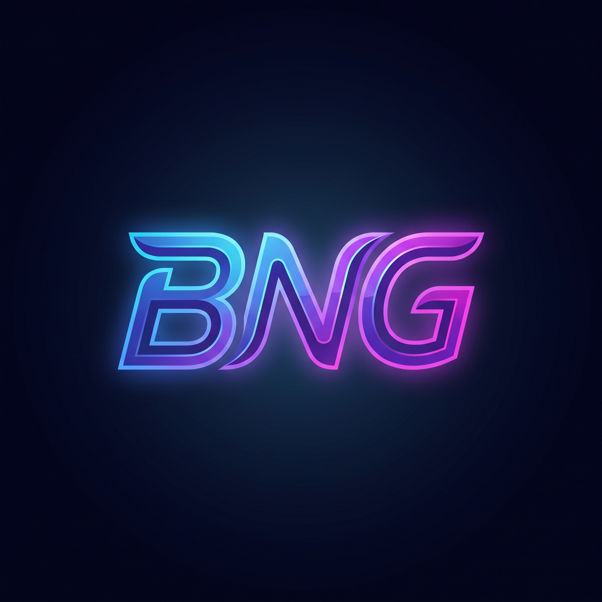

# behradNG

<p align="center">
  
</p>

<p align="center">
  <b>Fast & Secure V2Ray/Xray Android Client with ExpressVPN-Inspired Design</b>
</p>

<p align="center">
  <a href="https://github.com/dashbehrad/behradNG/releases"></a>
  <a href="https://developer.android.com/about/versions/nougat"></a>
  <a href="https://kotlinlang.org"></a>
  <a href="https://developer.android.com/jetpack/compose"></a>
  <a href="LICENSE"></a>
</p>

---

## 🌐 English

**behradNG** is a modern, high-performance V2Ray and Xray client for Android featuring an **ExpressVPN-inspired UI** and full support for adding your own custom proxy configurations.

### ✨ Key Features

- **🎨 ExpressVPN-Inspired Interface**:
  - **Giant Circular Power Button**: Iconic connect button with glowing green pulse animation when active and tactile haptic feedback.
  - **Live Status Header**: Clear "CONNECTED" / "NOT CONNECTED" banners with real-time tunnel telemetry.
  - **Selected Location Card**: Quick overview of the active server, protocol badge, real-time ping latency, and one-tap access to the server list.
  - **Quick Action Bar**: Shortcuts for adding configs, speed testing, routing modes, and split tunneling.
  - **Dual-Tab Experience**: Smooth navigation between the **Connect Dashboard** and **Configurations (Locations)**.

- **⚙️ Custom Configuration Management ("Add Configs Yourself")**:
  - **Import from Clipboard**: Automatically detects and parses configuration links.
  - **QR Code Scanner**: Built-in camera scanner powered by CameraX and ZXing.
  - **Local File Import**: Import `.json`, `.txt`, and backup files.
  - **Manual Configuration**: Support for creating custom servers from scratch.
  - **Subscription Management**: Auto-update and group support.

- **🚀 Protocol Support**:
  - **VLESS** (XTLS, Reality, WebSocket, gRPC, TCP, HTTP/2)
  - **VMess**
  - **Shadowsocks**
  - **Trojan**
  - **Hysteria2**
  - **WireGuard**
  - **SOCKS / HTTP**
  - **Policy Groups & Proxy Chains**

- **🛡️ Advanced Security & Routing**:
  - **Split Tunneling (Per-App Proxy)**: Choose which apps bypass or route through the VPN.
  - **Smart Routing Rules**: Bypass LAN and local IP addresses or route globally.
  - **DNS & Fragmentation**: Custom DNS servers, Fragment options, Mux, and sniffing.
  - **Speed & Latency Testing**: Real HTTP delay testing with instant results.

### 📥 Download & Installation

Download the latest prebuilt APK from the Releases section:

👉 **[Download behradNG Releases](https://github.com/dashbehrad/behradNG/releases)**

Every push to `master` or `main` automatically triggers **GitHub Actions** to compile and publish the latest APK to GitHub Releases.

---

## 🇮🇷 فارسی (Persian)

**behradNG** یک کلاینت مدرن، پرسرعت و امن V2Ray و Xray برای اندروید است که با طراحی جذاب **الهام‌گرفته از ExpressVPN** و امکان مدیریت کامل کانفیگ‌های اختصاصی توسعه یافته است.

### ✨ ویژگی‌های برجسته

- **🎨 طراحی شیک به سبک ExpressVPN**:
  - **دکمه اتصال بزرگ و دایره‌ای**: دکمه پاور معروف با انیمیشن پالس سبز رنگ در زمان اتصال و بازخورد لرزشی (Haptic).
  - **بنر وضعیت زنده**: نمایش وضعیت واضح «CONNECTED» یا «NOT CONNECTED» به همراه جزئیات امنیت تونل.
  - **کارت سرور انتخابی (Selected Location)**: نمایش نام کانفیگ فعال، پروتکل، پینگ زنده، دکمه تست سریع پینگ و جابجایی سریع به لیست سرورها.
  - **دسترسی سریع**: کلیدهای میانبر برای افزودن کانفیگ، تست سرعت، مسیریابی و پروکسی برنامه‌ها.
  - **دو تب اختصاصی**: سوییچ نرم بین داشبورد اتصال (Connect) و مدیریت کانفیگ‌ها (Configurations).

- **⚙️ افزودن و مدیریت کانفیگ‌های دلخواه**:
  - **کپی از کلیپ‌بورد (Clipboard)**: شناسایی خودکار لینک‌های پروکسی کپی‌شده.
  - **اسکن بارکد (QR Code)**: اسکنر دوربین پرسرعت داخلی.
  - **ورود از فایل**: پشتیبانی از فایل‌های متنی و پشتیبان.
  - **تنظیمات دستی (Manual)**: امکان ایجاد کانفیگ‌های جدید از صفر.
  - **پشتیبانی از سابسکریپشن (Subscription)**: دریافت و بروزرسانی خودکار لینک‌های اشتراک.

- **🚀 پروتکل‌های تحت پشتیبانی**:
  - **VLESS** (پشتیبانی از Reality، XTLS، WebSocket، gRPC، TCP)
  - **VMess**
  - **Shadowsocks**
  - **Trojan**
  - **Hysteria2**
  - **WireGuard**
  - **SOCKS و HTTP**
  - **Policy Groups و Proxy Chains**

- **🛡️ ابزارهای امنیتی و روتینگ**:
  - **تونل‌بندی اختصاصی (Per-App Proxy)**: انتخاب برنامه‌هایی که باید از فیلترشکن عبور کنند یا مستقیماً وصل شوند.
  - **قوانین مسیریابی (Routing Rules)**: عبور مستقیم ترافیک داخلی و وب‌سایت‌های محلی.
  - **تنظیمات DNS و فرگمنت (Fragment)**: کاهش اختلالات اینترنتی با قابلیت فرگمنت و Mux.
  - **تست پینگ واقعی (Real Ping)**: سنجش دقیق تأخیر پاسخگویی سرورها بر حسب میلی‌ثانیه.

### 📥 دانلود و نصب

برای دانلود آخرین نسخه، به بخش Releases در گیت‌هاب مراجعه کنید:

👉 **[صفحه دانلود نسخه‌های behradNG در GitHub](https://github.com/dashbehrad/behradNG/releases)**

با هر بار پوش کردن (`git push`) کدها در گیت‌هاب، **گیت‌هاب اکشنز (GitHub Actions)** به‌صورت خودکار پروژه را بیلد کرده و فایل نصبی APK را در بخش **Releases** قرار می‌دهد.

---

## 🛠️ Build & Development / توسعه و بیلد

### Prerequisites
- Android Studio Ladybug / Meerkat or later
- JDK 21
- Android SDK 36+

### Build with Gradle
```bash
# Debug APK
./gradlew assembleDebug

# Output location:
# app/build/outputs/apk/debug/app-debug.apk
```

### 🤖 GitHub Actions CI/CD Release
این پروژه مجهز به گردش‌کار خودکار گیت‌هاب اکشنز (`.github/workflows/build.yml`) است:
1. با هر `git push` به شاخه `master` یا `main` (یا ساخت تگ جدید مانند `v2.3.11`)، اکشن فعال می‌شود.
2. پکیج‌های پیش‌نیاز، کتابخانه‌های بومی (Core AAR و JNI) و ابزارهای بیلد آماده‌سازی می‌شوند.
3. فایل نصبی APK تولید شده و بلافاصله در بخش **Releases** همراه با توضیحات نسخه منتشر می‌شود.

---

## 📄 License
This project is licensed under the [GNU General Public License v3.0](LICENSE).
behradNG is a fork and customization of v2rayNG powered by Xray-core / v2ray-core.
